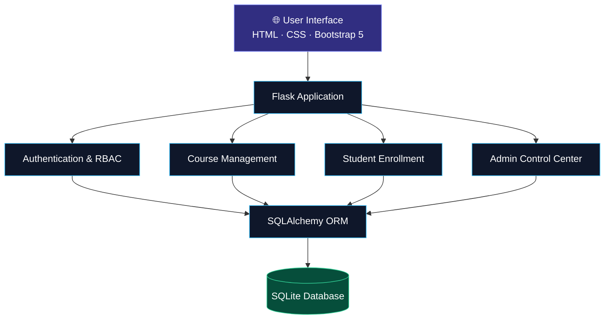
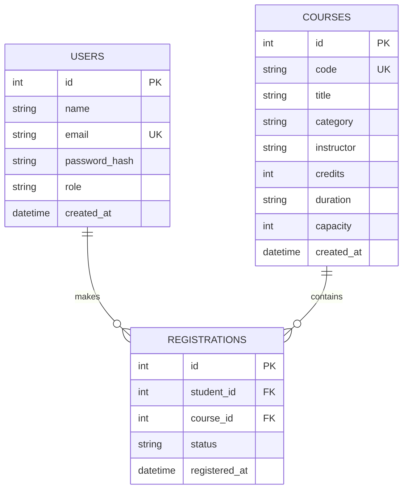
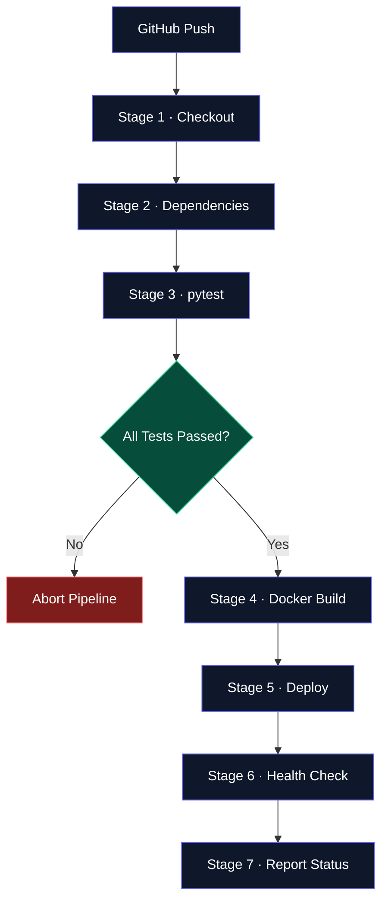

# ✦ Course Registration Platform
### Automated Academic Enrollment · End-to-End DevOps · CI/CD

<div align="center">

<!-- Replace this banner with your own project screenshot when available -->


<br/>

[](https://www.python.org/)
[](https://flask.palletsprojects.com/)
[](https://www.docker.com/)
[](https://www.jenkins.io/)

[](https://www.sqlalchemy.org/)
[](https://www.sqlite.org/)
[](https://getbootstrap.com/)
[](https://docs.pytest.org/)

<br/>

**A modern academic enrollment system engineered with secure role-based access, reliable database constraints, containerized deployment, and automated CI/CD.**

[Explore Features](#-key-features) · [Architecture](#-system-architecture) · [Installation](#-getting-started) · [CI/CD Pipeline](#-automated-cicd-pipeline)

</div>

---

## ◈ The Vision

> Build a reliable academic enrollment experience where students can discover courses, register with confidence, and manage their academic journey — while administrators maintain complete control over the curriculum.

The **Automated Course Registration Platform** is a full-stack academic portal built using Python, Flask, SQLAlchemy, and Bootstrap 5.

Beyond course registration, the project demonstrates how modern DevOps practices can improve software delivery through automated testing, Docker-based deployment, persistent storage, and Jenkins pipeline orchestration.

Every deployment is designed around a simple principle:

**Test first. Deploy safely. Verify everything.**

---

## ✧ At a Glance

<div align="center">

| 25 | 7 | 2 | 1 |
|:---:|:---:|:---:|:---:|
| Automated Tests | CI/CD Stages | User Roles | Academic Portal |

</div>

| Engineering Area | Implementation |
|---|---|
| Application | Flask-based full-stack academic portal |
| Authentication | Flask-Login with secure password hashing |
| Authorization | Role-Based Access Control |
| Database | SQLAlchemy + SQLite |
| Testing | pytest + Flask Test Client |
| Containerization | Docker + Docker Compose |
| Automation | Jenkins Declarative Pipeline |
| Deployment Verification | HTTP health endpoint |
| Data Persistence | Named Docker volume |

---

## ✨ Key Features

<div align="center">

### 🎓 Student Experience

</div>

- **Secure Authentication** — Register, sign in, sign out, and manage profiles.
- **Course Discovery** — Browse the course catalog with search and filtering.
- **Course Enrollment** — Register for available courses.
- **Live Capacity Information** — View course seat availability.
- **Student Dashboard** — Track enrolled courses and registered credits.
- **Course Cancellation** — Drop courses and release reserved seats.
- **Duplicate Protection** — Prevent duplicate course registrations.

<div align="center">

### 🛡️ Administrative Control

</div>

- **Admin Dashboard** — View enrollment statistics and key metrics.
- **Course Management** — Create, edit, and delete courses.
- **Capacity Management** — Enforce safe seat limits.
- **Enrollment Monitoring** — Review student registration records.
- **Audit Logs** — Track administrative enrollment activity.
- **Access Isolation** — Restrict administrative routes to authorized users.

<div align="center">

### ⚙️ DevOps & Automation

</div>

- Automated Jenkins pipeline execution.
- Isolated automated testing with pytest.
- Docker image building and container deployment.
- Non-root application container.
- Persistent SQLite storage through Docker volumes.
- Automated application health verification.
- Pipeline failure protection before deployment.

---

## ◈ System Architecture

The platform follows a modular Flask architecture with a dedicated DevOps pipeline.

### Application Architecture



### Automated Delivery Architecture

```mermaid
flowchart LR
    A["Developer"] -->|Git Push| B["GitHub"]
    B -->|SCM Trigger| C["Jenkins"]

    C --> D["Checkout"]
    D --> E["Dependencies"]
    E --> F["25 Automated Tests"]

    F -->|Pass| G["Docker Build"]
    F -->|Fail| X["Pipeline Aborted"]

    G --> H["Deploy Container"]
    H --> I["Health Verification"]
    I --> J["Deployment Report"]

    J --> K["Live Application"]

    classDef source fill:#312e81,stroke:#818cf8,color:#fff
    classDef pipeline fill:#0f172a,stroke:#38bdf8,color:#fff
    classDef success fill:#064e3b,stroke:#34d399,color:#fff
    classDef failure fill:#7f1d1d,stroke:#f87171,color:#fff

    class A,B source
    class C,D,E,F,G,H,I,J pipeline
    class K success
    class X failure
```



---

## ⚡ Technology Stack

<div align="center">

| Layer | Technology | Purpose |
|:---|:---|:---|
| Language | Python 3.11 | Application logic |
| Backend | Flask 3.1 | Modular web application |
| ORM | SQLAlchemy 2.0 | Database interaction |
| Database | SQLite 3 | Persistent academic records |
| Authentication | Flask-Login | Session management |
| Password Security | Werkzeug | Password hashing |
| Forms | Flask-WTF & WTForms | Validation and CSRF protection |
| Frontend | HTML5, CSS3, Bootstrap 5.3 | Responsive user interface |
| Templates | Jinja2 | Dynamic page rendering |
| Testing | pytest 9.1 | Automated verification |
| WSGI | Gunicorn 23.0 | Production application server |
| Containers | Docker | Application packaging |
| Orchestration | Docker Compose | Local container management |
| CI/CD | Jenkins | Automated delivery pipeline |
| Version Control | Git & GitHub | Source management |

</div>

---

## ◈ Database Design

The application uses a relational database model with three core entities.



### Database Integrity Rules

| Rule | Description |
|---|---|
| Unique Enrollment | A student cannot register for the same course twice. |
| Seat Availability | Enrollment is rejected when no seats are available. |
| Capacity Validation | Course capacity cannot be reduced below active enrollment. |
| Safe Course Deletion | Courses with active enrollments cannot be deleted. |
| Seat Release | Cancelling an enrollment releases the reserved seat. |
| Role Isolation | Students cannot access administrative routes. |

These rules are enforced through application logic, database constraints, and authorization checks.

---

## 🚀 Getting Started

Follow these steps to run the application locally.

### Prerequisites

Install the following:

- Python 3.11
- Git
- Visual Studio Code (recommended)

Verify your installation:

```bash
python --version
git --version
```

### 1. Clone the Repository

```bash
git clone https://github.com/vaishnvikedar6-jpg/course-registration-dashboard.git
```

Navigate into the project directory:

```bash
cd course-registration-dashboard
```

### 2. Create a Virtual Environment

**Windows — PowerShell**

```powershell
python -m venv venv
.\venv\Scripts\activate
```

**Linux / macOS**

```bash
python3 -m venv venv
source venv/bin/activate
```

### 3. Install Dependencies

```bash
python -m pip install --upgrade pip
python -m pip install -r requirements.txt
```

### 4. Launch the Application

```bash
python app.py
```

Open your browser:

| Page | URL |
|---|---|
| Home Portal | http://localhost:5000 |
| Course Catalog | http://localhost:5000/courses/ |
| Sign In | http://localhost:5000/login |
| Health Endpoint | http://localhost:5000/health |

---

## 🔐 Demo Credentials

The project documentation provides the following pre-seeded demo accounts.

| Role | Email | Password |
|---|---|---|
| Student | `student@university.edu` | `Student123!` |
| Administrator | `admin@university.edu` | `Admin123!` |

**Important:** These are development/demo credentials. Replace or disable them before exposing the application publicly.

---

## 🧪 Automated Testing

The platform includes a pytest suite covering authentication, course management, registration logic, administrative permissions, and health verification.

Run the complete test suite:

```bash
python -m pytest -v
```

### Test Coverage

| Test Module | Focus |
|---|---|
| `test_app.py` | Full student journey |
| `test_auth.py` | Authentication and authorization |
| `test_courses.py` | Catalog, search, filters, and course details |
| `test_registration.py` | Enrollment, cancellation, seat limits |
| `test_admin.py` | Administrative operations and capacity boundaries |
| `test_health.py` | Health endpoint and database failure detection |

### Verified Test Result

```text
============================= test session starts =============================
collected 25 items

25 passed in 18.93s

============================== 25 passed ================================
```

The test configuration uses isolated temporary SQLite databases to reduce interference between test cases.

---

## 🐳 Docker Deployment

Docker packages the application and its runtime dependencies into a portable container.

### Docker Compose — Recommended

Build and launch:

```bash
docker compose up -d --build
```

View logs:

```bash
docker compose logs -f
```

Inspect the running container:

```bash
docker ps
```

Stop the application:

```bash
docker compose down
```

The named Docker volume is designed to preserve application database data across container replacement.

### Docker CLI

Build the image:

```bash
docker build -t course-registration-platform:latest .
```

Create a persistent volume:

```bash
docker volume create course_registration_data
```

Run the container:

```bash
docker run -d \
  --name course-registration-container \
  --restart unless-stopped \
  -p 5000:5000 \
  -v course_registration_data:/app/data \
  -e DATA_DIR=/app/data \
  -e FLASK_CONFIG=production \
  -e SECRET_KEY=replace-with-a-secure-secret \
  course-registration-platform:latest
```

> **Security:** Replace the example secret with a securely generated value. Never commit production secrets to GitHub.

---

## ⚙️ Automated CI/CD Pipeline

The Jenkins Declarative Pipeline automates the application delivery lifecycle through seven stages.

<div align="center">

| Stage | Operation |
|:---:|---|
| 01 | Checkout GitHub Source |
| 02 | Validate Python Project & Install Dependencies |
| 03 | Run Automated Tests |
| 04 | Build Docker Image |
| 05 | Deploy New Application Version |
| 06 | Verify Application Health |
| 07 | Report Final Build Status |

</div>

### Pipeline Execution



### Quality Gate

The deployment process follows a strict quality gate:

- If tests pass, the pipeline proceeds to Docker packaging.
- If tests fail, deployment is aborted.
- The health verification stage checks the application endpoint.
- The final stage reports the pipeline outcome.

This approach reduces the risk of deploying unverified application changes.

---

## 🔄 Demonstrating the CI/CD Workflow

### Phase 1 — Initial Deployment

1. Open Jenkins.
2. Trigger the pipeline using **Build Now**.
3. Observe all seven pipeline stages.
4. Verify the automated test results.
5. Open the application at `http://localhost:5000`.
6. Sign in using the demo student account.
7. Enroll in an available course.

### Phase 2 — Demonstrate the Quality Gate

1. Open `tests/test_health.py`.
2. Temporarily modify an expected status code to an incorrect value.
3. Commit and push the change.

```bash
git add tests/test_health.py
git commit -m "test: simulate failing test"
git push origin main
```

4. Observe Jenkins detect the change.
5. Verify that the test stage fails.
6. Confirm that the deployment stages are skipped.

**Expected result:** The failed test prevents the new application version from being deployed.

### Phase 3 — Demonstrate Automatic Deployment

1. Restore the original test.
2. Update the homepage heading in `templates/index.html`.
3. Commit and push the changes.

```bash
git add templates/index.html tests/test_health.py
git commit -m "feat: update portal heading"
git push origin main
```

4. Observe the Jenkins pipeline.
5. Verify the successful test run.
6. Confirm the new version is deployed.
7. Refresh the application homepage.

The updated heading should now be visible.

---

## 📂 Project Structure

```text
course-registration-dashboard/
│
├── app.py
├── config.py
├── extensions.py
├── requirements.txt
│
├── Dockerfile
├── docker-compose.yml
├── Jenkinsfile
├── .dockerignore
├── .gitignore
│
├── models/
│   ├── __init__.py
│   ├── user.py
│   ├── course.py
│   └── registration.py
│
├── forms/
│   ├── __init__.py
│   ├── auth_forms.py
│   ├── course_forms.py
│   └── registration_forms.py
│
├── routes/
│   ├── __init__.py
│   ├── main.py
│   ├── auth.py
│   ├── courses.py
│   ├── student.py
│   ├── admin.py
│   └── errors.py
│
├── services/
│   ├── __init__.py
│   └── seed_service.py
│
├── utils/
│   ├── __init__.py
│   └── decorators.py
│
├── templates/
│   ├── base.html
│   ├── index.html
│   ├── auth/
│   ├── courses/
│   ├── student/
│   ├── admin/
│   └── errors/
│
├── static/
│   ├── css/
│   │   └── style.css
│   └── js/
│       └── main.js
│
├── tests/
│   ├── conftest.py
│   ├── test_app.py
│   ├── test_auth.py
│   ├── test_courses.py
│   ├── test_registration.py
│   ├── test_admin.py
│   └── test_health.py
│
└── README.md
```

---

## 🛠️ Troubleshooting

<details>
<summary><strong>Docker permission denied</strong></summary>

The Jenkins user may not have permission to access the Docker socket.

On Linux, review the Docker group permissions and restart Jenkins after making the appropriate configuration changes.

</details>

<details>
<summary><strong>Port 5000 is already in use</strong></summary>

Another process or container may already be listening on port 5000.

On Windows:

```powershell
netstat -ano | findstr :5000
```

Stop the conflicting process or configure a different port.

</details>

<details>
<summary><strong>SQLite database is locked</strong></summary>

This can occur when concurrent operations hold database locks.

Review SQLAlchemy session management, transaction boundaries, and database connection cleanup.

</details>

<details>
<summary><strong>Health check timeout</strong></summary>

The container may need more startup time.

Review the Docker health-check configuration and Jenkins retry logic.

</details>

---

## 📸 Project Demonstration Checklist

Use these screenshots in your project report, portfolio, and presentation.

- [ ] Home Page — Course Registration Portal
- [ ] Course Catalog — Search and filtering
- [ ] Student Dashboard — Enrollment details
- [ ] Course Detail — Registration interface
- [ ] Admin Dashboard — Key statistics
- [ ] Admin Course Management
- [ ] Enrollment Validation — Duplicate prevention
- [ ] Capacity Validation — Course full scenario
- [ ] Jenkins Pipeline — Seven stages
- [ ] Pytest — Automated test results
- [ ] Docker — Running application container
- [ ] Health Endpoint — Application verification

---

## 🌌 Future Enhancements

Potential extensions for the platform include:

- PostgreSQL integration for production database management.
- Cloud deployment with persistent storage.
- GitHub webhook-based pipeline triggering.
- Automated security scanning in the Jenkins pipeline.
- Enhanced observability with application metrics.
- Email notifications for registration events.
- Advanced student analytics.
- Improved administrative reporting.

---

## 👩‍💻 Author

<div align="center">

### Vaishnavi Kedar

Computer Engineering · Full-Stack Development · DevOps

Building reliable software through thoughtful engineering, automation, and modern development practices.

[](https://github.com/vaishnvikedar6-jpg)

</div>

---

<div align="center">

### ✦ Engineering beyond the interface.

**Designed for academic workflows. Built for reliable delivery.**


</div>
